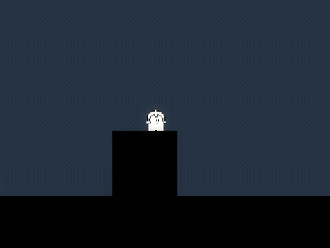

# 沃光（WarmaShadowTest）

> 一款用 **Godot 4.5 + GDScript** 独立开发的 **2D 像素风平台跳跃 + 类银河恶魔城探索** 原型。
> 核心体验：**蔚蓝式精准平台跳跃** × **空洞骑士式房间探索** × **能力解锁与回访**。
> 无主动攻击：玩家依靠跳跃、冲刺、攀墙、滑翔、超级冲刺等移动能力穿越房间、寻找收集品、完成挑战与竞速。
> 当前状态：**可运行原型**（2026-11），核心移动与 8 个区域、63 个房间场景、存档 / 对话 / 挑战系统已可运转，关卡内容仍在持续打磨。

<!--
  README 写作约定（保留，便于后续更新）：
  1. 规模数据来自当前提交 2c1290e 实测（2178 个跟踪文件：191 个 .gd / 166 个 .tscn / 166 张 png），更改后请同步更新。
  2. TODO 标记：下载链接、联系方式、素材授权说明。
  3. 截图占位：img/ 目录下目前是占位图，请替换为实机截图与 GIF。
-->

---

## 游戏简介

《沃光》是一款以“移动手感”为核心的 2D 像素平台跳跃游戏。玩家扮演小角色沃玛，在草原、洞穴、风之谷、雪山、城镇等多个区域之间探索：

- **房间制探索**：地图由独立房间场景组成，玩家从门进入新房间，逐步解锁能力后回到旧区域，打开此前无法到达的道路（类银河恶魔城循环）。
- **无战斗，靠移动说话**：没有普通攻击；危险来自关卡本身（尖刺、移动机关、雪崩、水、风）与敌人发出的弹幕。玩家通过精准的跳跃、冲刺与读图来克服挑战。
- **能力驱动的关卡语言**：冲刺、二段跳、滑翔、攀墙/墙跳、超级冲刺、暗影冲刺等能力解锁后，旧关卡会被重新解读。
- **收集与挑战**：金币、生命升级道具、可破坏墙壁后的隐藏区域、JumpBox 挑战关卡、竞速计时挑战、成就系统。

---

## 游戏演示介绍 (Gameplay Preview)

### 1. 精准跳跃与冲刺


<!-- 建议：3~6 秒 GIF，展示“土狼时间/跳跃缓冲/边缘修正”让擦边跳变成功，或一次干净的二段跳 + 冲刺落地 -->

### 2. 攀墙与墙跳


<!-- 建议：3~6 秒 GIF，展示贴墙下滑 → 墙跳 → 在两面墙之间连续弹跳 -->

### 3. 房间探索与能力解锁


<!-- 建议：5~8 秒 GIF，展示推门进入新房间 → 获得能力 → 回到旧房间打开新路 -->

### 4. 挑战 / 竞速模式


<!-- 建议：5~8 秒 GIF，展示 JumpBox 挑战的“完美触发”加分，或竞速计时器与终点结算 -->

### 静态截图

| 标题界面 | 草原区域 | 雪山区域 | 风之谷区域 |
|---|---|---|---|
|  |  |  | |

> **截取建议**：1280×720 原尺寸截图；GIF 建议 480~640 宽、10~15 FPS、单张小于 5 MB；上传到仓库根目录的 `img/` 文件夹后再修改上面路径。

---

## 核心功能与技术亮点 (Key Features)

### 🎮 玩家控制器与手感

- **18 个玩家状态**：`IDLE / MOVE / RUN / JUMP / DOWN / DASH / GLIDE / HURT / DIE / SLEEP / LOOKUP / LOOKDOWN / INTERACTIVE / WALLGRIP / WALLJUMP / SUPERDASHSTART / SUPERDASH`，每个状态对应一个 `handle_*_state()` 函数，由 `_physics_process` 统一分发，状态切换集中在 `change_state()` 一个入口。
- **平台游戏经典手感参数**（均可 Inspector 调整）：
  - 土狼时间 `coyote_time = 0.2s`、跳跃缓冲 `jump_buffer_time = 0.15s`；
  - 可变跳跃高度（按住跳跃 `max_jump_hold_time = 0.22s` 内持续获得上升力）；
  - 冲刺（`dash_speed = 450`，`dash_duration = 0.2s`）、超级冲刺（蓄力 `1.5s` → 最高 `3.5s`）、滑翔（下落速度倍率 `0.25`）、墙跳（水平 `320` / 垂直 `-150`，离墙后重新附着延迟 `0.2s`）。
- **帧率一致性**：物理帧率固定（`project.godot` 中 `physics_ticks_per_second` 为工程默认 60），`_physics_process` 中对 `delta` 做上限裁剪，加速度类参数按步长归一化，避免掉帧时“手感突变”。
- **移动平台**：`MovingPlatform` 独立控制移动，玩家与平台分离解耦，便于在场景中自由组合。
- **打击感**：Hit Stop（时间冻结）、相机抖动（多个预设强度）、残影（Trail 组件 + 对象池）。

### 🚪 房间系统与探索循环

- **房间即场景**：每个房间是独立的 `.tscn`（根节点挂 `Room.gd`，导出 `room_id`、`adjacent_rooms` 与房间边界），共 8 个区域 63 个房间。
- **按需加载**：`RoomManager` 只常驻“当前房间 + 相邻房间”，远处房间 `queue_free()` 释放；场景 `PackedScene` 做缓存，过门切换时先黑屏再加载，避免闪帧。
- **双门配对**：门通过 `door_id` 成对注册到 `DoorManager`，传送时查找目标门并让玩家从对应门走出，保证房间连接的一致。
- **检查点与存档点**：静态座椅存档点 + 动态检查点（死亡后从最近检查点复活）。

### 🧩 能力解锁与跨系统信号

- 能力（冲刺 / 二段跳 / 滑翔 / 暗影冲刺 / 攀墙 / 超级冲刺）保存在 `Global.unlocked_abilities` 中，解锁事件通过 `EventBus` 广播，玩家、UI、成就系统订阅同一信号，避免直接耦合。
- 二段跳、冲刺、滑翔、攀墙等状态会随能力解锁实时生效，未解锁时尝试触发会被忽略。

### 🏁 挑战与竞速

- **JumpBox 挑战**：挑战关卡中会按节奏生成 `ChallengeJumpBox` / `ChallengeMoveJumpBox`，踩中时判定“普通 / 完美”触发；完美触发得分更高，连续完美有额外加成。
- **挑战配置数据驱动**：每阶段挑战使用 `ChallengeConfig.tres` 配置挑战名、生成点与冷却时间，便于调整关卡节奏。
- **成就系统**：能力解锁类成就通过 `EventBus` 信号自动触发（仓库当前版本为成就基础框架，更多成就内容在规划中）。

### 🔊 音频、相机与表现

- **音频总线**：`Master / BGM / SFX / Voice` 四条总线，BGM 支持淡入淡出切换，音效携带空间位置（2D）。
- **相机**：基于 Phantom Camera 的跟随与限制框；进房间时自动写入房间边界作为相机限制，避免镜头拍到房间外。
- **视觉**：像素风坐标对齐（`stretch/mode=viewport` + `texture_filter=nearest`）、CanvasModulate 房间色调、Vignette 暗角（`VignetteEffect`）、残影 Shader、水面波纹 Shader。

### 🛠 工程质量

- **配置与逻辑分离**：挑战关卡、资源路径、物理层、输入映射集中管理（`ChallengeConfig.tres`、`ScenePaths`、`project.godot`）。
- **按键重映射**：玩家可在设置页重映射移动/跳跃/冲刺/超级冲刺/交互/对话键，并持久化到 `user://input_map.json`。
- **多菜单 UI**：标题页、存档选择、设置、游戏内设置、删除确认等 UI 场景，统一 Fade 过渡。
- **存档**：JSON 存档到 `user://saves/`，先写 `.tmp` 再改名为正式存档，降低“写一半崩溃导致存档损坏”的风险；支持多存档槽、删除与信息预览。

---

## 技术栈介绍 (Tech Stack)

| 分类 | 说明 |
|---|---|
| 引擎 | **Godot 4.5 Stable**（2D，GL Compatibility 渲染后端） |
| 语言 | **GDScript**（项目脚本 191 个 / 不含插件，全部由作者编写） |
| 物理 | `CharacterBody2D` + 自定义状态机，固定物理步长 + 物理插值 |
| 渲染 | 像素风 CanvasItem 渲染、Shader（残影、水面波纹）、CanvasModulate 房间色调 |
| 音频 | AudioStreamPlayer / AudioStreamPlayer2D + 自定义总线（Master/BGM/SFX/Voice） |
| 数据结构 | 字典 / 数组 / 枚举状态机 / Tween；自定义 `ChallengeConfig` Resource |
| 存档 | JSON（`user://`）+ 临时文件替换 + 多槽位 |
| 输入 | InputMap + 运行时按键重映射（JSON 持久化） |
| UI | Control 节点 + 场景切换 + Fade 过渡 |
| 第三方插件 | [Phantom Camera](https://github.com/ramokz/phantom-camera) 0.9.3.1（相机）、[Dialogue Manager](https://github.com/nathanhoad/godot_dialogue_manager) 3.10.2（对话）、[GodotIQ](https://godotiq.com)（开发期 AI 辅助，可在编辑器关闭） |
| 可选测试 | [GUT](https://github.com/bitwes/Gut) 9.5.0（已放入 `addons/gut`，当前未启用） |

---

## 操作说明 (Controls)

| 动作 | 键位 |
|---|---|
| 移动 | `A` / `D` |
| 向上 / 向下（沿墙移动、斜向冲刺等组合输入） | `W` / `S` |
| 跳跃 | `K`（按住跳得更高；空中可触发二段跳） |
| 冲刺 / 能力增强 | `L` |
| 超级冲刺 | `O`（长按蓄力，松开释放） |
| 攀墙 | 贴墙时朝墙方向移动 |
| 交互（对话 / 存档 / 开门） | `U` |
| 继续对话 | `Space` |
| 地图 / 返回（系统默认） | `Esc` |

小提示：
- 二段跳、冲刺、滑翔、攀墙需要在游戏中先解锁对应能力（与 NPC 对话获取）。
- 所有键位均可在“设置 → 控制”中重新映射，并自动保存到本地。

---

## 如何运行 (How to Run)

### 方式一：直接游玩

> TODO：在这里粘贴你的 **Windows 打包下载链接**（例如 GitHub Releases 或 itch.io / 网盘）。
> 建议同时提供 **Android APK 下载链接**。

1. 下载压缩包并解压；
2. 双击游戏主程序运行（无需安装 Godot）。

### 方式二：从源码运行

**环境要求**：Godot **4.5.x Standard**（非 .NET 版）。

```bash
# 1. 克隆仓库
git clone https://github.com/TurtledoveatriHub/WarGuang.git
cd WarGuang

# 2. 用 Godot 导入项目
#    打开 Godot 项目管理器 → Import → 选择 project.godot → Import & Edit

# 3. 首次导入后按 F5 运行
#    主场景：Scenes/UI/Scenes/TitleScene.tscn
```

也可以用命令行（Windows 示例）：

```powershell
# 运行项目
& 'C:\Path\To\Godot_v4.5-stable_win64.exe' --path 'D:\Path\To\WarGuang'

# 仅做一次资源导入（首次拉取仓库后建议执行）
& 'C:\Path\To\Godot_v4.5-stable_win64_console.exe' --headless --path 'D:\Path\To\WarGuang' --import
```

**导出 Android（可选）**：需安装 Android Build Template 与 SDK/NDK，在“项目 → 导出”中选择 Android 预设。

**关于插件**：`addons/godotiq` 是作者本地使用的 AI 辅助插件；如不需要，可在“项目设置 → 插件”中关闭它，不影响游戏运行。

---

## 项目规模

| 指标 | 数值 |
|---|---:|
| GDScript 脚本 | **191 个**（含 `.uid` 配对文件则更多；不含第三方插件） |
| 场景 `.tscn` | **166 个**（其中房间场景 63 个，覆盖 8 个区域目录） |
| 美术/音频资源 | 166 张 PNG、7 首 OGG 背景音乐、6 个 MP3、125 个 WAV 音效 |
| 全局自动加载单例（Autoload） | **21 个** |
| 玩家状态 | 18 个 |
| 仓库跟踪文件 | 2178 个（提交 `2c1290e`） |
| 核心脚本 | `Player.gd`（约 2,953 行）、`PlayerUI.gd`、`RoomManager.gd`、`MapManager.gd`、`Global.gd`、`SaveManager.gd`、`AudioManager.gd`、`CameraShakeManager.gd`、`ChallengeController.gd` |

> 说明：以上为当前提交 `2c1290e` 的实测数据；项目仍在持续开发，数字会随迭代变化。

---

## 项目结构（简）

```text
warma-shadow-test/
├─ project.godot          # 工程配置：输入映射、自动加载、物理/渲染
├─ Scripts/
│  ├─ Player/             # 玩家控制器（Player.gd、PlayerUI、HUD）
│  ├─ Managers/           # 全局管理器（房间、存档、音频、场景切换、全局状态…）
│  ├─ GameScenes/         # 游戏场景逻辑（主场景、房间、门）
│  ├─ Instances/          # 可放置实例（JumpBox、HurtBox、平台、存档点…）
│  ├─ Components/         # 可复用组件（残影轨迹、挑战控制器）
│  ├─ NPCs/               # NPC 行为与对话
│  └─ UI/                 # UI 场景脚本
├─ Scenes/                # 对应场景（Player、UI、房间、实例、NPC、管理器）
├─ Assets/                # 美术、音频、字体、Shader、配置 Resource、对话文本
└─ addons/                # 第三方插件（Phantom Camera / Dialogue Manager / GUT）
```

---

## 已知问题与后续计划

- **房间布局仍在施工**：包含若干测试与占位房间，部分区域（如 Atlantis、Dream）只有目录，关卡尚未完成。
- **无主动战斗**：受设计取舍影响，目前没有普通攻击；敌人以移动障碍和弹幕为主。
- **手柄支持**：尚未配置手柄映射。
- **测试**：尚未编写自动化测试（GUT 已放入项目，计划后续补充冒烟测试）。
- **后续计划**：完善关卡与能力解锁顺序、补全音乐、优化手机端性能、补充演示视频与自动化测试。

---

## 开发者 (Developer)

- **作者**：TurtledoveatriHub（个人独立开发）
- **GitHub**：[@TurtledoveatriHub](https://github.com/TurtledoveatriHub)
- **联系方式**：TODO（邮箱 / B 站 / 社交主页）
- **项目动机**：以《蔚蓝》《空洞骑士》等作品为学习对象，练习 2D 平台跳跃的手感打磨、房间制关卡设计与独立游戏完整开发流程。