# 沃光（WarmaShadowTest）

> 一款用 **Godot 4.5 + GDScript** 独立开发的 **2D 像素风平台跳跃 + 类银河恶魔城探索** 原型。
> 核心体验：**蔚蓝式精准平台跳跃** × **空洞骑士式房间探索** × **能力解锁与回访**。
> 无主动攻击：玩家依靠跳跃、冲刺、攀墙、滑翔、超级冲刺等移动能力穿越房间、寻找收集品、完成挑战与竞速。
> 当前状态：**可运行原型**（2026-11）—— 19 个玩家状态、8 个区域 / 63 个房间、能力解锁、存档、对话、挑战与竞速系统均已可运转，关卡内容仍在持续打磨。

<!--
  README 写作约定（保留，便于后续更新）：
  1. 规模数据实测自当前工作区：188 个 .gd、147 个 .tscn、154 张 png、7 首 ogg、125 个 wav，
     仓库跟踪文件 1616 个（提交 6ebbb88）；改动后请同步更新「项目规模」表。
  2. TODO 标记：下载链接（Windows / Android）。
  3. 截图：img/ 下已有 4 张 1280×720 静态截图；演示 GIF 待录制后按占位注释替换。
  4. 授权：本仓库为「源码可见（Source-Available）」，并非开源，条款见 LICENSE。
-->

---

## 📌 给 AI 助手 / 新协作者的最速上手（60 秒版）

> 这一节就是「让一个全新的 agent 快速接手」的入口；下面的章节是展开阅读。**先读这一节，再按需跳读。**

| 项目 | 内容 |
|---|---|
| 引擎 | Godot **4.5.1 Standard**（非 .NET）；命令行用 `Godot_v4.5.1-stable_win64_console.exe` |
| 入口 | 主场景 `Scenes/UI/ScenesUI/TitleScene.tscn` → 标题 → 存档 → 房间 |
| 玩家 | `Scenes/Player/Player.tscn` + `Scripts/Player/`（`Player.gd` 只存数据/生命周期，行为在 43 个 `*Service.gd`） |
| 全局 | 26 个 Autoload（`Global` / `EventBus` / `ScenePaths` / `RoomManager` / `AudioManager` …），列表见 `project.godot` |
| 校验 | `godot --headless --path <项目> --editor --quit`（全量导入 + 编译，必须 0 error / 0 warning） |
| 运行期验证 | 写一个一次性 `tools/_tmp_xxx.tscn` 场景，用 `godot --headless --path <项目> res://tools/_tmp_xxx.tscn` 跑，跑完删除 |

**三条硬规则**：① 编辑器必须 **0 error / 0 warning**，不接受“已知警告先忽略”；② 任何脚本改动后都要跑一次上面的 `--editor --quit` 校验；③ 资源路径不硬编码，走 `ScenePaths` 常量或 `class_name`。

**三条禁忌**：① 不用 `git reset --hard` / 丢弃别人未提交的改动；② 不在编辑器正在运行同项目时反复导出（导出会重写 `.godot` 缓存，建议先关掉编辑器实例）；③ 不把 `preload("res://…")` 当依赖注入用（会导致循环引用与路径漂移）。

**汇报格式**：改了哪些文件 → 为什么改 → 怎么验证的（能给实测数字就给数字）。

---

## 游戏简介

《沃光》是一款以“操作手感”为核心、2D 像素平台跳跃 + 类银河恶魔城大地图探索的冒险游戏；
一个架空的世界观中，玩家扮演小角色沃玛，在草原、洞穴、风之谷、雪山、城镇等多个区域之间探索，不断推进故事剧情、解锁各种能力、获得各种道具、触发各种事件，在帮助这个陌生的世界的过程中，接触世界的真相……

- **房间制探索**：地图由独立房间场景组成，玩家从门进入新房间，逐步解锁能力后回到旧区域，打开此前无法到达的道路（类银河恶魔城循环）。
- **无战斗，靠移动说话**：没有常规攻击手段；在各种危险（尖刺、移动机关、水、火、雪崩、敌怪）中，玩家通过精准的跳跃、冲刺与读图来克服挑战。
- **能力驱动的关卡语言**：冲刺、二段跳、滑翔、攀墙/墙跳、超级冲刺、暗影冲刺等能力解锁后，旧关卡会被重新解读。
- **收集与挑战**：金币、生命升级道具、可破坏墙壁后的隐藏区域、JumpBox 挑战关卡、竞速计时挑战、成就系统。

---

## 角色部分能力机制介绍 (Gameplay Preview)

> 演示 GIF 待录制；当前可先看下方静态截图。下面的占位图按建议内容准备好后直接替换即可。

### 1. 精准跳跃

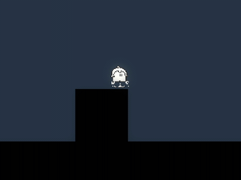
- 短按跳跃键起跳，长按跳得更高 -->

- 跳跃时按方向键可正常控制跳跃方向 -->
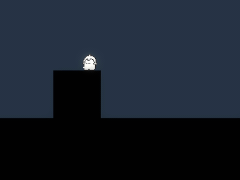
- 奔跑状态下跳跃跳得更远，叠加“土狼时间（离开平台后短时间内仍然可以正常跳跃）”达到最长跳跃距离 -->

### 2. 二段跳与jumpbox触发

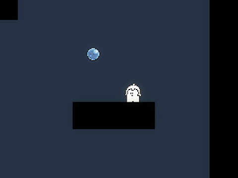
- 二段跳时如果持续按住跳跃键，则本次空中持续保持二段跳动画状态 -->
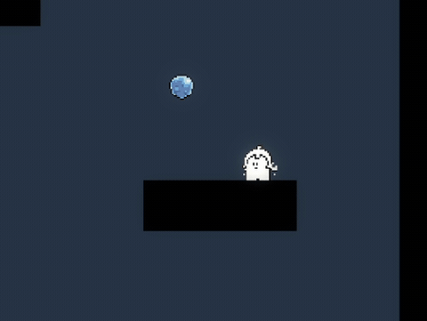
- 二段跳状态期间触碰jumpbox -->
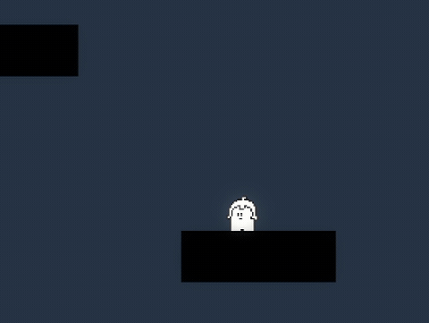
- 进入二段跳的瞬间触碰jumpbox -->

### 3. 冲刺、纵向冲刺、黑暗冲刺

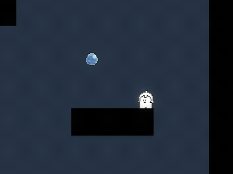


- 多变的冲刺能力让操作更多样 -->

### 4. 滑翔

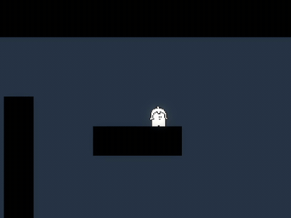
- 二段跳后再次按跳跃键进入滑翔 -->

### 5. 攀墙与墙跳

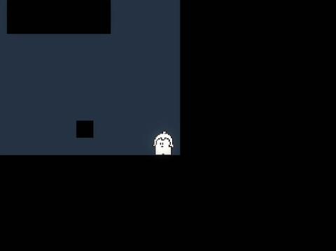
- 获得攀墙能力后，空中接触墙体时会进入攀墙状态，在攀墙状态下按跳跃键会自动向离墙方向进行跳跃，同样可控跳跃高度，此时按住向墙方向键则可再次攀墙 -->

### 6. 超级冲刺

- 获得超级冲刺能力后，按住超级冲刺键进行充电，达到充电时间后松开按键进行超级冲刺，超级冲刺持续0.2秒后可使用跳跃、冲刺等手段打断超级冲刺 -->

### 手感修正（奔跑连续 / 边缘修正）

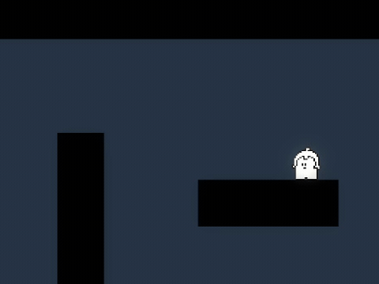
- 奔跑时如果持续按住奔跑方向键，此时进行跳跃或其它动作后回到地面仍然保持奔跑状态，保证奔跑连贯性 -->
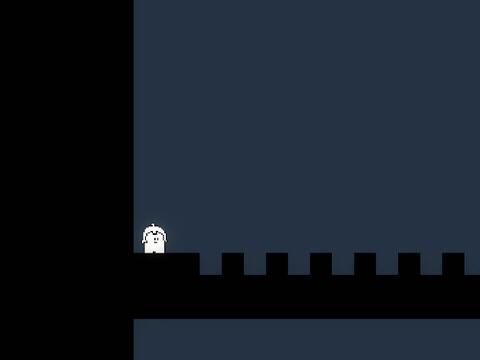
- 奔跑时如果遇到低矮障碍（约4px）会尝试抬升，不会因为小断口而掉落，保证奔跑连贯性 -->
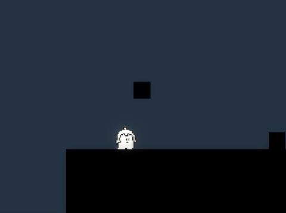
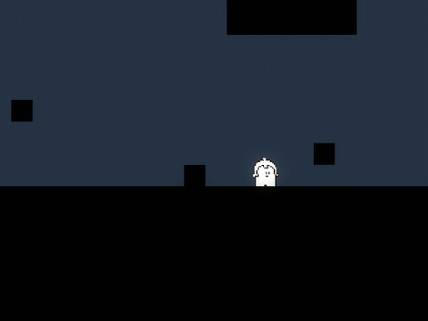
- 跳跃（包括墙跳）、冲刺时，如果位移方向有碰撞体，则会多次尝试小幅度偏移绕开碰撞体，但如果预测无法绕开则不会进行修正 -->

### 场景简略预览

| 标题界面 | 草原区域 | 雪山区域 | 风之谷区域 |
|---|---|---|---|
|  | 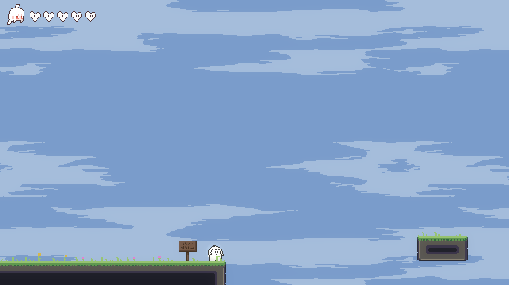 | 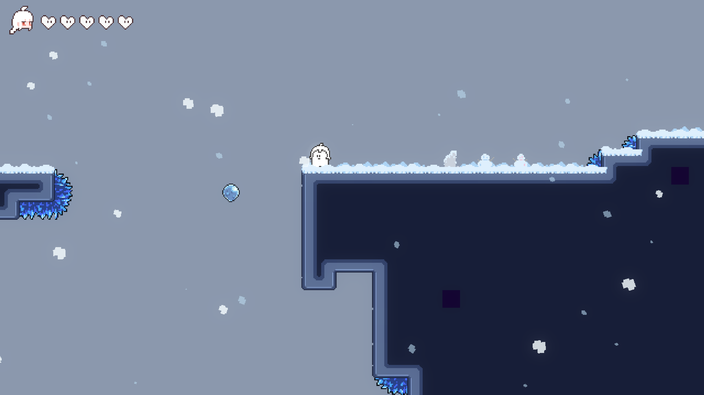 | |

---

## 核心功能与技术亮点 (Key Features)

### 🎮 玩家控制器与手感

- **19 个玩家状态**：`IDLE / MOVE / RUN / JUMP / DOWN / DASH / GLIDE / HURT / DIE / SLEEP / LOOKUP / LOOKDOWN / INTERACTIVE / RIDECART / WALLGRIP / WALLJUMP / SUPERDASHSTART / SUPERDASH / BACKSTEP`。
  `Player.gd` 只保留状态数据与生命周期；逐帧分发在 `PlayerStateFlowService.handle_state()`（一个 `match` 调用 19 个 `handle_*_state()`），具体行为再下沉到 `Scripts/Player/` 下的 43 个服务脚本（移动、空中能力、滑翔、相机、残影、音效、伤害流程、房间过渡……），状态切换统一走 `change_state()` 一个入口。
- **基础移动**：行走 `120` / 奔跑 `220`（px/s），地面加速 `0.8s`、地面减速 `0.7s`；空中加速度 `1320`、空中控制系数 `0.52`；超速时按 `360 px/s²` 衰减，避免松开冲刺后“刹不住”。
- **跳跃**：起跳速度 `-90`、二段跳 `-60`、重力 `900`、最大下落 `480`；按住跳跃键在 `0.2s` 内持续获得 `-28` 的额外上升力，实现可变跳跃高度。
- **手感修正（Jump / Wall-Jump / Dash Correction）**——本项目最花时间打磨的部分：
  - **边缘修正**：每帧 `move_and_slide` 之前，先用 `PhysicsShapeQueryParameters2D` 探测“本帧位移之后的未来位置”；如果只差一个极小的角点被卡住，就沿垂直方向按 `0.5px` 一档逐级微移（跳跃 6 档 / 墙跳 8 档 / 冲刺 8 档），一找到空位立刻平移过去，动作不中断。贴着平台边缘起跳、横向冲刺擦着墙角穿过，都是靠它救回来的。
  - **跑出边缘台阶修正**：奔跑中撞到高度 ≤ `4px` 的矮台阶时，先向前探测 `6px` 确认确实被挡住，再从 `1px` 开始逐像素抬高，找到第一个“抬上去还能继续前进”的高度就抬过去，并还原被 `move_and_slide` 清掉的水平速度——否则玩家会在台阶上“顿”一下再重新加速。
  - **墙跳修正**：优先方向固定为“离墙方向”，避免连续墙跳时被吸回墙面。
  - **单向平台穿越**：按下 + 跳跃会开一个 `0.2s` 的穿越窗口，窗口内所有边缘修正主动让路——否则台阶修正会把玩家抬回平台顶面，表现成“抽搐一下、既没穿过去也没跳起来”。
  - **土狼时间 `0.1s` / 跳跃缓冲 `0.12s`**：离开边缘后短时间内仍可起跳，落地前按下的跳跃会被缓冲并自动执行。
- **冲刺**：水平 `360` / 竖直 `300`，持续 `0.14s`（暗影冲刺 `0.16s`），起手 `0.05s` 内可微调方向；出冲刺保留 `45%` 速度（`dash_exit_speed_retention`），冷却 `0.6s`。
- **超级冲刺**：长按蓄力 `1.2s`，最高 `420 px/s`，加速 `0.3s` / 减速 `0.6s`，最长持续 `2.5s`，带残影拖尾与输入锁。
- **滑翔**：水平目标速度 `160`，下落速度上限压缩到 `22%`，起手悬停 `0.12s`；松手后有 `0.28s` 输入冷却，防止误触反复开合。
- **攀墙 / 墙跳**：贴墙下滑 `280`、按住慢速下滑 `90`，贴墙判定 `0.12s`；墙跳水平 `90` / 垂直 `-160`，离墙后 `0.1s` 才能重新附着，按住可再获得 `-42` 的额外上升力。
  - **风场里的攀墙豁免**：在 `EnvironmentZone` 的风场中攀墙时，若该区域的水平风速 `|wind_max_velocity.x|` ≤ `wall_grip_ignore_wind_max_x`（默认 `120 px/s`），水平风不施加——否则逐帧位移会把玩家推出墙射线范围，表现为“一贴墙就被吹掉”；超过阈值则照常吹离，保留“强风区无法逆风攀墙”的关卡设计。垂直方向的风（上升/下压气流）在墙上仍然生效。
- **后撤步**：`0.12s` / `180 px/s`，带 `0.1s` 反击窗口与短暂无敌。
- **帧率一致性**：`max_physics_ticks_per_second = 60` + `physics_interpolation = true`，`_physics_process` 里把 `delta` 裁到 `1/30s` 上限（并除以 `Engine.time_scale`，慢镜头下同样成立），所有加速度按步长归一化，掉帧不会造成手感突变。
- **移动平台 / 矿车**：`Platform` / `MineCart` 各自控制位移，玩家只做“跟随 + 被推出”，不与平台源码互相耦合。
- **打击感**：Hit Stop（时间缩放冻结）、相机抖动（`CameraShakeManager` 提供按轴向的强/弱预设，每个预设独立配强度、时长、速度与衰减曲线，并按相机限制框裁剪偏移）、残影（`AfterimageTrail` + `AfterimagePool` 对象池）、像素稳定（`PlayerPixelStabilityService`）。

### 🚪 房间系统与探索循环

- **房间即场景**：每个房间是独立的 `.tscn`（根节点挂 `Room.gd`，导出 `room_id`、`adjacent_rooms`、`room_bounds`、房间 BGM 与色调），共 8 个区域目录、63 个房间（草原 18 / 雪山 21 / 风之谷 13 / 城镇 7 / 洞穴 3 / 其它 1）。
- **按需加载**：`RoomManager` 只常驻“当前房间 + 相邻房间”，远处房间 `queue_free()` 释放；场景 `PackedScene` 做缓存，过门切换先黑屏再加载，避免闪帧。
- **双门配对**：门通过 `door_id` 成对注册到 `DoorManager`，传送时查找目标门并让玩家从对应门走出，保证房间连接一致。
- **检查点与存档点**：静态座椅存档点 + 动态检查点（`DynamicCheckpointManager`，死亡后从最近检查点复活）。

### 🧩 能力解锁与跨系统信号

- 9 项能力（`dash / double_jump / glide / black_dash / wall_grip / super_dash / backstep / vertical_dash / map`）统一保存在 `Global.unlocked_abilities`，解锁通过 `EventBus` 广播，玩家、UI、成就系统订阅同一信号，避免直接耦合。
- 二段跳、冲刺、滑翔、攀墙等状态随能力实时生效；未解锁时触发会被忽略，旧存档缺少新字段时自动补默认值。

### 🏁 挑战与竞速

- **JumpBox 挑战**：挑战关卡中按节奏生成/激活 `JumpBox`，踩中时判定“普通 / 完美”触发（完美窗口 `0.12s`，可通过二段跳起手时间命中）；完美触发力度 ×`1.8`、水平加成 ×`1.75`、并可回血。
- **数据驱动配置**：挑战分 7 个阶段（`Assets/Configs/ManiacStages/ManiacStage1~7Config.tres`），竞速分 5 段（`Assets/Configs/RaceStages/RaceStage1~5Config.tres`），改名、生成点、冷却都在 Resource 里调，不改代码即可调关节奏。
- **计分**：普通触发基础分、完美触发基础分，连续完美累进加分并在第 8 次封顶（`ChallengeController`）。
- **成就系统**：`AchievementManager` + `AchievementToast` 弹出提示，能力解锁类成就由 `EventBus` 信号自动触发（框架已就绪，内容持续补充）。

### 🔊 音频、相机与表现

- **音频总线**：`Master / BGM / SFX / Voice` 四条总线（`Assets/Audios/default_bus_layout.tres`）；BGM 支持淡入淡出与 Ducking（受伤时压低 BGM），Ducking 的恢复目标是“基准音量”而非“调用时的当前音量”，因此连续受伤不会累积压低、闪避结束后一定回到原音量；音效带头部空间位置与优先级队列（最多 16 个并发实例、按优先级限流、对象池复用）。
- **相机**：基于 Phantom Camera 的跟随与限制框；进房间时自动写入房间边界作为相机限制，避免镜头拍到房间外。
- **视觉**：像素风坐标对齐（`stretch/mode=viewport` + `scale_mode=integer` + `texture_filter=nearest`）、CanvasModulate 房间色调、Vignette 暗角（`VignetteEffect`）、残影（`AfterimageShader`）、地图揭示（`MapReveal`）、成就图标（`AchievementIcon`）；水面由 `PixelWaterSurface` 脚本驱动像素波纹。
- **环境粒子**：`EnvironmentZoneBase` 统一了“区域形状 + 粒子朝向/速度 + 效果强度变化”，派生出 `UpdraftZone`（上升气流）、`EnvironmentZone`（风场/水流，可开关或时间循环）、`BubbleColumnZone`（水下气泡柱）等；粒子的 `visibility_rect` 按区域实际尺寸动态写入，超长区域也不会出现“飞到一半粒子消失”。风场由 `wind_max_velocity / wind_acceleration / wind_deceleration / wind_ground_scale` 描述，另带攀墙豁免阈值 `wall_grip_ignore_wind_max_x`（默认 `120`）。

### 🛠 工程质量

- **配置与逻辑分离**：挑战/竞速配置走 `.tres`，资源路径集中在 `ScenePaths`（Autoload，唯一路径表：目录常量 + 15 个 UI 场景 + 玩家/NPC/主场景 + 63 个房间），物理层与输入映射集中在 `project.godot`；脚本之间尽量用 `class_name` 而非 `preload("res://…")` 硬编码路径。
- **按键重映射**：玩家可在设置页重映射移动/跳跃/冲刺/超级冲刺/交互/对话键，并持久化到 `user://input_map.json`。
- **多菜单 UI**：标题、存档选择、设置、游戏内设置、删除确认、成就、更新说明、地图、传送、竞速 HUD 等 15 个 UI 场景，统一 Fade 过渡与 `UIRouter` 路由。
- **存档**：JSON 存档写入 `user://saves/`，先写 `.tmp` 再改名，降低“写一半崩溃导致存档损坏”的风险；支持多槽位、删除与信息预览。
- **可验证性**：所有改动都会跑 `godot --headless --editor --quit` 做全量导入 + 编译校验，并用一次性的 headless 场景脚本验证运行期行为（本项目维护 0 error / 0 warning 的底线）。

---

## 技术栈介绍 (Tech Stack)

| 分类 | 说明 |
|---|---|
| 引擎 | **Godot 4.5.1 Stable**（2D，GL Compatibility 渲染后端，1280×720，`viewport` 拉伸 + 整数缩放） |
| 语言 | **GDScript**（项目脚本 188 个 / 不含插件，全部由作者编写） |
| 物理 | `CharacterBody2D` + 自定义状态机；固定物理步长（60Hz）+ `physics_interpolation` + `PhysicsShapeQueryParameters2D` 形状探测 |
| 美术 | 使用 Aseprite、Resprite 纯手绘完成角色、场景与 UI 像素资源绘制 |
| 渲染 | 像素风 CanvasItem 渲染、Shader（残影 / 暗角 / 地图揭示 / 成就图标）、CanvasModulate 房间色调、GPUParticles2D 环境粒子 |
| 音频 | AudioStreamPlayer / AudioStreamPlayer2D + 自定义总线（Master/BGM/SFX/Voice）+ 优先级队列与对象池 |
| 数据结构 | 字典 / 数组 / 枚举状态机 / Tween；自定义 `ChallengeConfig` Resource |
| 存档 | JSON（`user://`）+ 临时文件替换 + 多槽位 |
| 输入 | InputMap + 运行时按键重映射（JSON 持久化）+ 移动端虚拟按键 HUD |
| UI | Control 节点 + 场景切换 + Fade 过渡 + 统一 UIRouter |
| 第三方插件 | [Phantom Camera](https://github.com/ramokz/phantom-camera) 0.9.3.1（相机）、[Dialogue Manager](https://github.com/nathanhoad/godot_dialogue_manager) 3.10.2（对话）、Tile Copy 1.0 by wyfyjc（TileMap 复制）、[GodotIQ](https://godotiq.com) 0.5.1（开发期 AI 辅助，可在编辑器关闭） |

---

## 操作说明 (Controls)

| 动作 | 键位 |
|---|---|
| 移动（左右） | `A` / `D` |
| 向上 / 向下（向上冲刺、向下冲刺、沿墙移动、单向平台下穿） | `W` / `S` |
| 跳跃 | `K`（按住跳得更高；空中再按触发二段跳） |
| 冲刺 / 能力增强 | `L` |
| 超级冲刺 | `O`（长按蓄力，松开释放） |
| 攀墙 | 贴墙时朝墙方向移动 |
| 交互（对话 / 存档 / 开门） | `U` |
| 继续对话 | `Space` |
| 地图 | `Tab`（需先在商人处购买「地图」能力） |
| 返回 / 关闭界面 | `Esc` |

小提示：
- 冲刺、二段跳、滑翔、攀墙、超级冲刺、暗影冲刺、后撤步、地图都需要先在游戏中解锁（与 NPC 对话获取）。
- 所有键位均可在“设置 → 控制”中重新映射，并自动保存到本地。

---

## 如何运行 (How to Run)

### 方式一：直接游玩

> TODO：在这里粘贴 **Windows 打包下载链接**（例如 GitHub Releases）。
> 建议同时提供 **Android APK 下载链接**。

1. 下载压缩包并解压；
2. 双击游戏主程序运行（无需安装 Godot）。

### 方式二：从源码运行

**环境要求**：Godot **4.5.x Standard**（非 .NET 版）。

```bash
# 1. 克隆仓库
git clone https://github.com/TurtledoveatriHub/WarGuang.git
cd WarGuang

# 2. 用 Godot 导入项目
#    打开 Godot 项目管理器 → Import → 选择 project.godot → Import & Edit

# 3. 首次导入后按 F5 运行
#    主场景：Scenes/UI/ScenesUI/TitleScene.tscn
```

也可以用命令行（Windows 示例）：

```powershell
# 运行项目
& 'C:\Path\To\Godot_v4.5-stable_win64.exe' --path 'D:\Path\To\WarGuang'

# 仅做一次资源导入（首次拉取仓库后建议执行）
& 'C:\Path\To\Godot_v4.5-stable_win64_console.exe' --headless --path 'D:\Path\To\WarGuang' --import
```

**导出 Android（可选）**：需安装 Android Build Template 与 SDK/NDK，在“项目 → 导出”中选择 Android 预设。

**关于插件**：`addons/godotiq` 是作者本地使用的 AI 辅助插件，会在编辑器里尝试占用 `6007` 端口；如不需要，可在“项目设置 → 插件”中关闭它，不影响游戏运行。

## 项目规模

| 指标 | 数值 |
|---|---:|
| GDScript 脚本 | **188 个**（不含 `addons/`，全部由作者编写） |
| 场景 `.tscn` | **147 个**（房间 63 个 / UI 15 个 / 实例、实体与工具场景 69 个） |
| 美术 / 音频 | 154 张 PNG、7 首 OGG（BGM）、125 个 WAV（音效） |
| 全局自动加载单例（Autoload） | **26 个**（23 个自研 + 3 个来自插件） |
| 玩家状态 | 19 个（由 43 个服务脚本共同实现） |
| 区域 / 房间 | 8 个区域目录 / 63 个房间场景 |
| 仓库跟踪文件 | 1616 个（提交 `6ebbb88`） |

核心脚本行数：

| 文件 | 行数 | 职责 |
|---|---:|---|
| `Player.gd` | 1824 | 玩家节点、状态数据、生命周期、对外接口 |
| `MapManager.gd` | 1323 | 大地图烘焙与绘制、房间布局拼接 |
| `HurtBox.gd` | 1066 | 伤害体：直线/波浪/圆周/大摆锤、发射器、触发器、周期开关 |
| `Global.gd` | 910 | 全局进度：能力、金币、道具、Boss、存档序列化 |
| `PlayerUI.gd` | 756 | 玩家 HUD（血量、金币、气泡、提示） |
| `PlayerMovementService.gd` | 611 | 地面/空中移动与各状态的具体实现 |
| `AudioManager.gd` | 509 | BGM 淡入淡出、Ducking、SFX 优先级与对象池 |
| `CameraShakeManager.gd` | 445 | 相机抖动预设与噪声 |
| `RoomManager.gd` | 430 | 房间按需加载、邻接、缓存 |
| `PlayerStateFlowService.gd` | 321 | 19 个状态的逐帧分派 |

> 说明：以上为当前工作区实测数据；项目仍在持续开发，数字会随迭代变化。

---

## 项目结构（简）

```text
warma-shadow-test/
├─ project.godot          # 工程配置：输入映射、26 个 Autoload、物理/渲染
├─ LICENSE                # 源码可见许可协议（非开源，仅供学习）
├─ Scripts/
│  ├─ Player/             # Player.gd + 43 个服务脚本；PlayerUI/ 为玩家 HUD
│  ├─ Managers/           # 21 个管理器脚本（房间、场景、存档、音频、地图、UI 路由…）
│  ├─ GameScenes/         # 房间基类 Room.gd、门、视差、隐藏区域
│  ├─ Instances/          # 可放置实例：HurtBox / JumpBox / Platform / EnvironmentZone /
│  │                      #   SavePoint / MineCart / Props / ObjectPools / TileAnim …
│  ├─ Entities/           # 敌人 Enemys/、中立生物 Neutrals/、NPCs/
│  ├─ UI/                 # GameUI（地图/传送/竞速 HUD/气球）、ScenesUI（标题/设置/存档…）、UIFx
│  ├─ Resources/          # ChallengeController、ChallengeConfig、AfterimagePool
│  ├─ Events/             # 开场演出 BootCinematicDirector
│  └─ Tools/              # 开发期工具脚本（房间扫描、校验）
├─ Scenes/                # 与 Scripts 一一对应的场景（UI 同样分 GameUI / ScenesUI）
│  └─ GameScenes/Rooms/   # 8 个区域目录、63 个房间场景
├─ Assets/                # 美术、音频、字体、Shader、Configs（挑战/竞速）、Dialogues
├─ addons/                # 第三方插件（Phantom Camera / Dialogue Manager / Tile Copy / GodotIQ）
├─ tools/                 # 项目外的 headless 校验脚本（不参与游戏运行）
└─ img/                   # README 截图与 GIF
```

---

## 已知问题与后续计划

- **房间布局仍在施工**：`Atlantis`、`Dream` 两个区域目前只有目录，关卡尚未开始制作；其余区域也有测试与占位房间。
- **无主动战斗**：受设计取舍影响，目前没有普通攻击；危险来自关卡机关与敌怪弹幕。
- **手柄支持**：尚未配置手柄映射（键盘 + 移动端虚拟按键可用）。
- **自动化测试**：未引入 GUT 等测试框架；当前靠 `tools/` 下的一次性 headless 脚本做行为验证，计划后续补冒烟测试。
- **已知技术债**：`HurtBox` / `JumpBox` / `Platform` 三套往返移动代码高度相似（加减速 + 端点等待），可以抽成共享组件；`Player.gd` 仍有部分逻辑可继续下沉到服务脚本。
- **后续计划**：完善关卡与能力解锁顺序、补全音乐与演示视频、优化手机端性能、补自动化测试。

---

## 开发者 (Developer)

- **作者**：斑鸠at
- **GitHub**：[@TurtledoveatriHub](https://github.com/TurtledoveatriHub)
- **联系方式**：谷歌邮箱 turtledoveatri@gmail.com / QQ 邮箱 hzw718295@qq.com / B 站 https://space.bilibili.com/689333617

> 本项目为个人独立作品 / 求职作品集项目，欢迎交流与指正；如需商用或转载请注明并联系作者。
